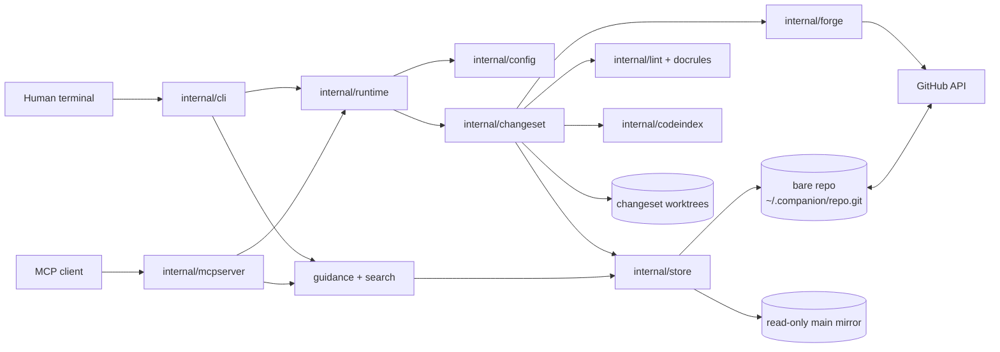

# Architecture

Repo Companion is a local Go CLI with an embedded MCP server. Git and GitHub
remain the source of truth; the local state directory is a cache and a set of
working trees.



## Read path

1. `runtime.Session` resolves project, team, domain, and languages from flags,
   environment, `.companion.yaml`, user config, the store registry, and Git.
2. `changeset.Manager.Overlay` combines the read-only `main` mirror with the
   active changeset worktree. Pending documents are visible with a `source` and
   `state`; deleted documents are tombstoned.
3. `internal/guidance` ranks patterns, ADRs, and standards; `internal/search`
   provides local BM25 search; `internal/export` renders the same overlay for
   non-MCP agents.
4. `internal/codeindex` validates `reference_impls` paths and, where a provider
   exists, symbols. Go uses the native provider; other languages may use ctags;
   otherwise validation is reported as unverified.

Reads are local. A network call is only made for operations such as `pull`,
PR status, review comments, or a PR-specific read.

## Write path

1. A changeset gets a branch and a worktree under `~/.companion/changes/`.
2. `docs_write`, `docs_patch`, `docs_move`, and `docs_delete` validate the
   canonical path and frontmatter, require `base_rev` for existing files, scan
   for likely secrets, commit immediately, and roll back the file if the commit
   fails.
3. `change sync` commits, integrates the remote branch, pushes with
   `--force-with-lease`, and creates or updates a draft PR.
4. `change submit` runs lint and code-reference preflight, rebases on `main` if
   needed, marks the PR ready, and freezes the changeset. A human merges.

## Safety boundaries

- **Paths:** `store.CleanRel`, `store.EnsureArea`, and
  `changeset.safeWorktreePath` reject absolute paths, traversal, `.git`, and
  symlink escapes. Config and registry reads use the same containment rules.
- **Main is read-only:** the mirror is chmodded read-only. Direct edits are
  possible only by changing permissions; `change adopt` is the supported way to
  move accidental mirror edits into a changeset.
- **Agents are bounded:** there is no MCP merge, abandon, or cleanup tool.
  Security-sensitive user config is CLI-only.
- **Credentials:** tokens come from the environment, user config, or `gh`.
  Remote URLs are redacted in diagnostics. User config, state, and archives use
  private file modes.
- **Concurrency:** per-area file locks serialize Git work; `state.json` has its
  own cross-process lock and is rebuildable.
- **No daemon:** no listener, polling loop, or telemetry.

## Package map

| Package | Responsibility |
|---|---|
| `cmd/companion` | Process entry point and exit-code mapping |
| `internal/cli` | Cobra commands, flags, human/JSON output |
| `internal/mcpserver` | MCP tools, resources, prompts, roots, pagination |
| `internal/runtime` | Wires config, store, forge, state, and changesets per session |
| `internal/config` | Layered configuration, context resolution, registry |
| `internal/store` | Bare repo, mirror, document parsing, contained reads |
| `internal/changeset` | Worktrees, overlays, sync, submit, writes, reconciliation |
| `internal/forge` | GitHub REST and GraphQL operations |
| `internal/docrules` | Canonical layout and frontmatter validation |
| `internal/lint` | Structural lint, links, metadata, likely secrets |
| `internal/guidance` | Task-based ranking and code context attachment |
| `internal/search` | Dependency-free BM25 index |
| `internal/codeindex` | Go, ctags, and fallback reference validation |
| `internal/importdocs` | Legacy Markdown tree classification and migration report |
| `internal/export` | Managed AGENTS.md, llms.txt, and JSON/Markdown bundles |
| `internal/secret` | Local credential heuristic |
| `internal/state` | Rebuildable changeset cache |
| `internal/version` | Shared CLI/MCP build version |

## Storage layout

```text
~/.companion/
├── repo.git/                  # bare clone of the docs store
├── main/                      # read-only mirror of main
├── changes/                   # one worktree per changeset
├── cache/code/<repo>/<commit>/ # code index snapshots
├── archive/                   # opt-in patches for discarded changesets
├── locks/                     # per-area locks
└── state.json                 # rebuildable changeset cache
```

User configuration lives at `~/.config/companion/config.yaml` on Unix-like
systems and `%APPDATA%\companion\config.yaml` on Windows.
